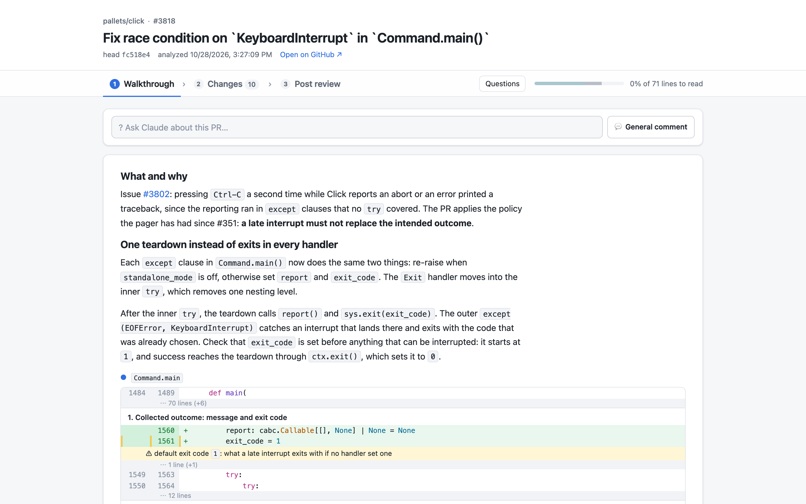

# PR Sift

Review GitHub pull requests by what matters: architecture, interfaces
and behavior. Renames, comments, docstrings and formatting are filtered
out, and what you reviewed is remembered across force-pushes. From
the report you can ask Claude about any line, unit or paragraph, draft
comments, and post them as a GitHub review. Python repositories only,
for now.



[Open the demo](docs/demo/index.html): the report of that pull request,
[pallets/click#3818](https://github.com/pallets/click/pull/3818), as a
static page. Review marks there last until you close it, and asking
Claude and drafting comments need `pr-sift serve`.

See [docs/design.md](docs/design.md) for how it works.

## Install

Requires Python 3.12+, [uv](https://docs.astral.sh/uv/), `git`, and
the GitHub CLI `gh`, logged in.

```bash
uv tool install git+https://github.com/slidoapp/pr-sift
pr-sift skill install
```

The second command links the `/pr-sift` skill, which comes with the
package, into `~/.agents/skills`, and from there into
`~/.claude/skills` and `~/.codex/skills` if you use Claude Code or
Codex. `uv tool upgrade pr-sift` upgrades the command and the skill
together.

Or paste this to your agent:

```text
Install PR Sift (https://github.com/slidoapp/pr-sift) for me. Check
that uv, git and the GitHub CLI gh are installed and that gh is logged
in, and tell me how to fix anything missing. Then run
`uv tool install git+https://github.com/slidoapp/pr-sift` and
`pr-sift skill install`, and tell me what was installed. If I use a
Chromium browser, also run `pr-sift extension install` and walk me
through loading the Chrome extension from the folder it prints.
```

## Use

In Claude Code, from any directory:

```
/pr-sift https://github.com/owner/repo/pull/123
/pr-sift owner/repo#123
```

Or ask in your own words, like "review pallets/click#3818". You
don't need the code checked out: pr-sift keeps its own clone of each
repository it reviews. Inside a checkout of the repository,
`/pr-sift 123` takes the repository from its remote, and `/pr-sift`
alone reviews the PR of the current branch.

Or run the analysis yourself, with the same ways to name the PR:

```bash
pr-sift analyze 123 --out analysis.json   # or owner/repo#123, or a PR URL
pr-sift serve 123                         # open the report in the browser
pr-sift export 123 --out report.html      # or save it as one static page
pr-sift status
pr-sift extension install                 # connect the Chrome extension
```

The report takes you through three steps: read the **Walkthrough**,
review the **Changes** unit by unit, then **Post review**. Hover a
line and click **+**, or select lines or walkthrough text, to write a
comment draft or ask Claude about it (keys `c` and `a`). Questions run
`claude -p` in a checkout of the PR head, with read-only file tools
and web search, using your Claude Code login and default model.
Questions are private; **Draft a comment** has Claude turn a thread
into a short review comment for you to edit. Drafts stay local until
you post them: preview where each one goes, then post them as one
GitHub review through `gh`.

Data lives in `~/.local/share/pr-sift` and repository clones in
`~/.cache/pr-sift`; set `PR_SIFT_DATA_DIR` and `PR_SIFT_CACHE_DIR`
to move them.

Optional settings go in `~/.config/pr-sift/config.toml`
(`PR_SIFT_CONFIG_DIR` moves it):

```toml
[agent]
command = "claude"            # the agent CLI that answers questions
web_fetch = true              # false: it can search the web but not open pages
web_fetch_domains = []        # e.g. ["docs.python.org", "pypi.org"] to allow only these
max_parallel = 3
timeout_seconds = 300
```

## Chrome extension

The extension puts a PR Sift card on GitHub pull request pages: sift
the PR without leaving GitHub, see how much is left to read and
whether the PR moved on since the sift, and open the report next to
the PR. Chrome starts `pr-sift` itself when the extension needs it,
through native messaging, so nothing has to be running.

```bash
pr-sift extension install
```

Then open `chrome://extensions`, turn on Developer mode, click
**Load unpacked** and choose the folder the command prints: the
extension inside the installed package. After upgrading pr-sift,
click the extension's reload button there. Chrome, Chromium, Brave,
Edge and Arc are supported; pass `--browser-dir <user data directory>`
for another Chromium browser or profile location. Run the install
again after reinstalling pr-sift or changing your `PATH`, since Chrome
starts `pr-sift` with the `PATH` you had when you installed it.

**Sift this PR** runs the pr-sift skill headless with `claude -p` and
your Claude Code login: it analyzes and ranks the PR, then the card
shows **Open report**. The run continues if you close the tab. Only
github.com for now.

## Develop

```bash
uv sync
uv run pytest
```

To run pr-sift and the skill from your checkout, install it in
editable mode, so changes take effect without reinstalling:

```bash
uv tool install --editable . --force
pr-sift skill install
```

To rebuild the demo after changing the report page:

```bash
pr-sift analyze 3818 --repo pallets/click --out /dev/null
pr-sift ingest 3818 docs/demo/ranking.json --repo pallets/click
pr-sift export 3818 --repo pallets/click --out docs/demo/index.html
```

## License

[MIT](LICENSE)
